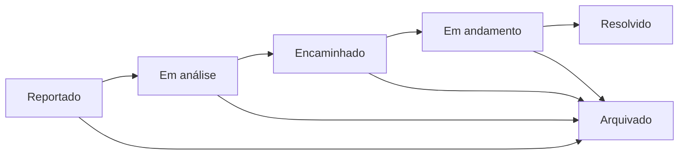
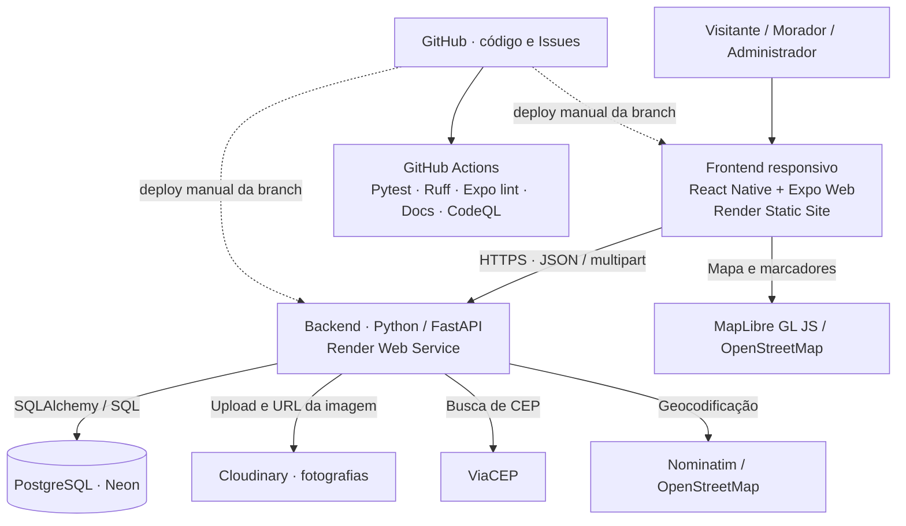

# Amigo da Vizinhança

[](https://github.com/Felipeand01/Proj_Lab_Engenharia_de_Software-/actions/workflows/backend-tests.yml?query=branch%3Atg3-implementation)
[](https://github.com/Felipeand01/Proj_Lab_Engenharia_de_Software-/actions/workflows/codeql.yml?query=branch%3Atg3-implementation)

**Plataforma colaborativa para registro e acompanhamento de problemas de infraestrutura urbana.**

Projeto acadêmico da disciplina **Laboratório de Engenharia de Software**, da Universidade Presbiteriana Mackenzie — **Turma 06D**, etapa **TG3 (2026)**.

**Integrantes:** Eduardo Kenji Hernandes Ikematu, Felipe Marques Leite Martha e Felipe Matos de Souza.

| Acesso rápido | Link |
|---|---|
| **Aplicação web publicada** | [amigo-vizinhanca-web.onrender.com](https://amigo-vizinhanca-web.onrender.com/) |
| **API publicada** | [amigo-vizinhanca-api.onrender.com](https://amigo-vizinhanca-api.onrender.com/) |
| **Documentação interativa da API** | [Swagger /docs](https://amigo-vizinhanca-api.onrender.com/docs) |
| **Vídeo de demonstração** | [Assistir no YouTube](https://youtube.com/shorts/QGAQztvfltM) |
| **Testes automatizados no GitHub Actions** | [Execução da TG3 — commit `617c048`](https://github.com/Felipeand01/Proj_Lab_Engenharia_de_Software-/actions/runs/44473687672) |
| **Código da entrega** | [Branch `tg3-implementation`](https://github.com/Felipeand01/Proj_Lab_Engenharia_de_Software-/tree/tg3-implementation) |

> **Atenção:** este é um protótipo acadêmico de participação comunitária. As atualizações de status são **demonstrativas**: o cadastro de uma ocorrência **não gera protocolo oficial, não comunica automaticamente a prefeitura e não comprova que um serviço público foi executado**.

## Sumário

1. [Retomada dos objetivos](#retomada-dos-objetivos)
2. [Evolução do projeto e escolha da versão web](#evolução-do-projeto-e-escolha-da-versão-web)
3. [Principais funcionalidades alcançadas](#principais-funcionalidades-alcançadas)
4. [Perfis de acesso e como utilizar](#perfis-de-acesso-e-como-utilizar)
5. [Arquitetura do sistema](#arquitetura-do-sistema)
6. [Tecnologias utilizadas](#tecnologias-utilizadas)
7. [Como executar localmente](#como-executar-localmente)
8. [API REST e regras de negócio](#api-rest-e-regras-de-negócio)
9. [Testes automatizados e integração contínua](#testes-automatizados-e-integração-contínua)
10. [Publicação na nuvem](#publicação-na-nuvem)
11. [Dificuldades e experiências durante o deploy](#dificuldades-e-experiências-durante-o-deploy)
12. [Demonstração da aplicação em produção](#demonstração-da-aplicação-em-produção)
13. [Limitações e pontos de melhoria](#limitações-e-pontos-de-melhoria)
14. [Potencial de continuidade](#potencial-de-continuidade)
15. [Estrutura do repositório e histórico das entregas](#estrutura-do-repositório-e-histórico-das-entregas)

## Retomada dos objetivos

Buracos no asfalto, falhas de iluminação, acúmulo de lixo e outros problemas de infraestrutura fazem parte do cotidiano das cidades. Um mesmo problema pode ser percebido por vários moradores, mas nem sempre existe uma maneira simples de consultar os relatos já feitos em determinada região e acompanhar sua situação.

O **Amigo da Vizinhança** nasceu da proposta de reunir esses registros em um único ambiente, com informações de localização, categoria, descrição e fotografia. O objetivo é favorecer a **visibilidade dos problemas urbanos e a participação da comunidade**, evitando a fragmentação de relatos e permitindo que os moradores acompanhem o histórico de cada ocorrência.

O fluxo central do produto é:

1. Consultar as ocorrências existentes no mapa ou na lista.
2. Confirmar um problema já registrado, caso o morador também o tenha observado, **ou** publicar uma nova ocorrência com fotografia e localização.
3. Acompanhar o status e o histórico da ocorrência.
4. Permitir que a equipe administradora modere registros, atualize status demonstrativos e consulte indicadores.

A proposta se relaciona ao **ODS 11 — Cidades e Comunidades Sustentáveis**, ao incentivar a participação comunitária e a organização de informações sobre zeladoria urbana. **As confirmações não determinam prioridade de atendimento nem comprovam a veracidade do relato.**

## Evolução do projeto e escolha da versão web

O planejamento da **TG1 — Definição do Produto de Software** previa um aplicativo móvel desenvolvido com React Native e Expo. A TG2 estabeleceu a integração inicial entre frontend, API FastAPI e PostgreSQL. Durante a TG3, essa base foi ampliada até contemplar os fluxos principais do MVP.

**Mudança aprovada pelo professor:** após a apresentação do **Checkpoint 2 da TG3**, o grupo recebeu a aprovação do professor para **priorizar a aplicação web** como formato da entrega. A solução final utiliza **React Native com Expo Web**, mantendo a organização em componentes do projeto original, mas disponibilizando o sistema pelo navegador, com interface responsiva para desktop e telas móveis.

A opção permitiu concentrar a entrega na integração de todos os serviços, nos testes e na demonstração pública da solução, sem depender da instalação de um aplicativo no dispositivo do avaliador. **Não foi publicado um pacote instalável de Android ou iOS nesta etapa.** A experiência web constitui a versão disponibilizada e validada da TG3.

Essa decisão não alterou o objetivo do produto: os papéis, o cadastro de ocorrências, a confirmação comunitária, o fluxo de status, o histórico e a moderação continuam alinhados à proposta inicial da TG1.

## Principais funcionalidades alcançadas

| Funcionalidade | Resultado na TG3 |
|---|---|
| Consulta pública | Navegação sem login por ocorrências em **mapa ou lista**, com detalhes, fotografia, categoria, localização e status. |
| Filtros | Filtros por categoria e status, além da consulta por recorte geográfico da área do mapa. |
| Cadastro e autenticação | Criação de contas de moradores, login, logout, autenticação por token e controle de permissões. |
| Registro de ocorrência | Categoria, título, descrição, **fotografia obrigatória** e localização confirmada; status inicial **Reportado**. |
| Localização | Seleção no minimapa, uso da localização autorizada pelo usuário e busca por CEP/endereço, com alternativas quando serviços externos falham. |
| Fotografias | Validação e tratamento das imagens, com integração a armazenamento externo quando configurado. |
| Confirmação comunitária | Cada morador pode confirmar **uma vez** uma ocorrência de outro autor; novas tentativas são impedidas. |
| Área do morador | Consulta separada de ocorrências **criadas** e **confirmadas**. |
| Histórico de status | Registro cronológico do status inicial e das alterações posteriores. |
| Administração | Painel com indicadores por categoria e status; transições controladas e arquivamento com motivo obrigatório. |
| Visibilidade de arquivadas | Registros arquivados deixam de aparecer na consulta pública; permanecem consultáveis pelo administrador e pelo próprio autor em sua área. |
| Qualidade | Testes automatizados, validações de código, documentação gerada e publicação em nuvem. |

### Fluxo de vida de uma ocorrência



- O sistema atribui **Reportado** automaticamente ao cadastrar a ocorrência.
- **Somente o administrador** pode alterar o status, seguindo as transições permitidas.
- O arquivamento exige um motivo, preserva o registro e o histórico e remove o relato da listagem pública.
- **Resolvido** e **Arquivado** são estados finais nesta versão, sem reabertura.
- O acompanhamento é **interno e demonstrativo**, sem integração oficial com órgãos públicos.

## Perfis de acesso e como utilizar

### Visitante — sem conta

Pode navegar pela aba **Explorar**, alternar entre mapa e lista, utilizar filtros e consultar os detalhes públicos. Para cadastrar ou confirmar uma ocorrência, deve se autenticar.

### Morador — conta criada pelo próprio usuário

1. Acesse a [aplicação web](https://amigo-vizinhanca-web.onrender.com/).
2. Abra **Conta → Criar conta**.
3. Informe nome, e-mail e senha conforme as validações exibidas na interface. A senha deve ter **pelo menos 8 caracteres** e não pode ser uma senha comum ou igual ao e-mail.
4. Conclua o cadastro: a conta é criada com perfil **Morador**, sem opção de escolher privilégios administrativos.
5. Acesse **Conta → Entrar**, informe e-mail e senha e faça login.
6. Utilize **Registrar** para publicar uma ocorrência com foto e localização; em **Minhas**, acompanhe suas ocorrências criadas ou confirmadas.
7. Para encerrar a sessão, utilize **Conta → Sair**.

Um morador pode confirmar relatos de **outros** moradores uma única vez, mas **não pode** mudar seus status, arquivar ocorrências nem acessar o painel administrativo.

### Administrador — conta previamente preparada

A aplicação dispõe de **conta administrativa de demonstração**, criada/preparada pela equipe para validação dos recursos exclusivos deste perfil. **E-mail e senha de administrador não são divulgados neste README nem versionados no repositório**; quando necessário para avaliação, o acesso é fornecido diretamente pela equipe.

No código, o provisionamento de um administrador é feito de forma controlada pelo script `backend.app.seed`, utilizando `ADMIN_EMAIL`, `ADMIN_SENHA` e, opcionalmente, `ADMIN_NOME` no ambiente do servidor; **o cadastro público sempre cria moradores**.

O administrador pode consultar o painel com totais por status e categoria, analisar ocorrências, avançar o fluxo de status e **arquivar** relatos com justificativa. Ele **não** publica nem confirma ocorrências como morador.

| Recurso | Visitante | Morador | Administrador |
|---|:---:|:---:|:---:|
| Consultar mapa, lista, filtros e detalhes públicos | Sim | Sim | Sim |
| Criar conta de morador | Sim | — | — |
| Registrar ocorrência | Não | Sim | Não |
| Confirmar ocorrência de outro autor | Não | Sim, uma vez | Não |
| Acompanhar próprias ocorrências | Não | Sim | — |
| Atualizar status ou arquivar | Não | Não | Sim |
| Consultar indicadores administrativos | Não | Não | Sim |
| Consultar registros arquivados | Não | Apenas os próprios | Sim |

## Arquitetura do sistema

A solução segue uma arquitetura **cliente-servidor**, com uma interface web que consome uma API REST. A API aplica as regras de negócio e acessa serviços separados para persistência relacional, imagens e geocodificação.



**Fluxo de uma publicação:** formulário web → API FastAPI → validação da fotografia e dos dados → armazenamento da foto → gravação da ocorrência e de seu histórico no PostgreSQL → resposta à interface. O banco guarda a **URL da imagem**, não o arquivo binário.

**Entidades principais do domínio:** `usuarios`, `categorias`, `ocorrencias`, `confirmacoes`, `historico_status` e `tokens_revogados`. A integridade da confirmação única e da chave de reenvio da ocorrência também é reforçada por restrições do banco de dados.

### Tecnologias utilizadas

| Camada | Tecnologias | Responsabilidade |
|---|---|---|
| Frontend | React Native, React, Expo, Expo Router e React Native Web | Interface web responsiva, navegação e formulários. |
| Mapa | MapLibre GL JS e OpenStreetMap | Exibição de marcadores e seleção geográfica na versão web. |
| Geolocalização/endereço | Expo Location, ViaCEP e Nominatim | Posicionamento autorizado, consulta de CEP e geocodificação. |
| Backend | Python 3.12, FastAPI, Pydantic e Uvicorn | API REST, validações, regras de negócio e controle de acesso. |
| Persistência | SQLAlchemy, PostgreSQL e Neon | Entidades, relacionamentos, consultas e dados em produção. |
| Imagens | Pillow e Cloudinary | Validação, redimensionamento e armazenamento de fotos. |
| Autenticação | JWT, Argon2 e controle por perfil | Hash de senhas, sessão, autorização e revogação de tokens no logout. |
| Deploy | Render (Static Site e Web Service) | Hospedagem da interface e da API. |
| Desenvolvimento | Git, GitHub, Codespaces e Docker Compose | Versionamento, colaboração e banco de desenvolvimento. |
| Testes e CI | Pytest, FastAPI TestClient, HTTPX, Playwright, Ruff, Expo ESLint, CodeQL e GitHub Actions | Testes, análise estática e verificações automatizadas. |
| Documentação | FastAPI/OpenAPI, pdoc e pytest-html | Referência da API, documentação de código e relatórios de testes. |

## Como executar localmente

**Pré-requisitos:** Git, **Python 3.12**, **Node.js 22**, npm e **Docker com Docker Compose**. Os comandos abaixo são para Linux/WSL ou terminal Bash de um GitHub Codespace, partindo da raiz do repositório.

### 1. Obter o código e configurar o ambiente

```bash
git clone --branch tg3-implementation https://github.com/Felipeand01/Proj_Lab_Engenharia_de_Software-.git
cd Proj_Lab_Engenharia_de_Software-
cp .env.example .env
```

Edite o arquivo `.env` para inserir um `JWT_SECRET` seguro. É possível gerar um valor com:

```bash
python -c "import secrets; print(secrets.token_urlsafe(48))"
```

Substitua a linha `JWT_SECRET=` do `.env` pelo segredo gerado. Para o desenvolvimento local, os demais valores de exemplo correspondem ao PostgreSQL do `docker-compose.yml`. **Nunca compartilhe o arquivo `.env`, tokens ou senhas reais.**

O código lê variáveis do ambiente do processo; portanto, carregue-as no terminal que iniciará o backend:

```bash
set -a
source .env
set +a
```

Variáveis relevantes:

| Variável | Finalidade |
|---|---|
| `DATABASE_URL` | Conexão com PostgreSQL; o exemplo aponta para o Docker local. |
| `JWT_SECRET` | **Obrigatório**; segredo de assinatura dos tokens, com pelo menos 32 caracteres. |
| `JWT_EXPIRA_MINUTOS` | Tempo de validade de tokens (padrão: 60). |
| `CORS_ORIGINS` | Origens autorizadas a chamar a API; inclua o frontend utilizado. |
| `FOTO_STORAGE` | `local` no desenvolvimento; `cloudinary` para hospedagem persistente de fotografias. |
| `FOTO_MAX_BYTES` | Tamanho máximo recebido de imagem (padrão: 5 MiB). |
| `CLOUDINARY_CLOUD_NAME`, `CLOUDINARY_API_KEY`, `CLOUDINARY_API_SECRET` | Necessários no backend ao usar `FOTO_STORAGE=cloudinary`. |
| `ADMIN_EMAIL`, `ADMIN_SENHA`, `ADMIN_NOME` | Usados **somente** ao executar o script controlado de criação de administrador. |
| `EXPO_PUBLIC_API_URL` | URL pública da API **no build do frontend de produção** (não é segredo). |

Consulte [`.env.example`](.env.example) para as opções principais. As configurações locais não devem utilizar o banco Neon de produção.

### 2. Iniciar o PostgreSQL local

```bash
docker compose up -d db
docker compose ps
```

O banco de desenvolvimento responde na porta `5432`.

### 3. Instalar e iniciar a API

```bash
python -m venv .venv
source .venv/bin/activate
pip install -r backend/requirements-dev.txt
python -m backend.app.init_db
uvicorn backend.app.main:app --host 127.0.0.1 --port 8000 --reload --reload-dir backend
```

O comando `init_db` prepara as tabelas e insere as cinco categorias iniciais: **Iluminação, Limpeza, Infraestrutura, Segurança e Outros**. Em um **banco já existente**, antes de atualizar o esquema, utilize o procedimento de migração documentado em `backend/app/migrar.py` e faça backup. **Não aplique migrações de desenvolvimento diretamente ao Neon de produção.**

Se for necessário testar funcionalidades administrativas localmente, defina `ADMIN_EMAIL` e `ADMIN_SENHA` no `.env`, carregue as variáveis e execute **uma vez**:

```bash
python -m backend.app.seed
```

O script cria a conta administrativa quando o e-mail ainda não existe; caso já exista uma conta comum com o e-mail informado, promove-a sem alterar sua senha. Não publique as credenciais.

Acesse:

- [API local](http://localhost:8000/)
- [Swagger local](http://localhost:8000/docs)
- [Health da API](http://localhost:8000/health)
- [Conexão com o banco](http://localhost:8000/db-health)

### 4. Instalar e iniciar o frontend

Em **outro terminal**, na raiz do repositório:

```bash
cd mobile
npm ci
npx expo start --web --port 8081
```

Abra [http://localhost:8081](http://localhost:8081). Em desenvolvimento local, a versão web identifica automaticamente a API em `http://localhost:8000`. No Codespaces, configure as portas encaminhadas e o CORS conforme os endereços gerados pelo ambiente.

**GitHub Codespaces:** abra o projeto na branch `tg3-implementation` e crie um Codespace. O arquivo `.devcontainer/devcontainer.json` prevê as portas **8000** e **8081**. Execute os mesmos comandos de banco, backend e frontend e utilize a aba **Ports** do VS Code para abrir a interface no navegador; ajuste `CORS_ORIGINS` para a origem pública da porta do Expo.

### 5. Executar os testes

De volta à raiz, com o ambiente Python de desenvolvimento preparado:

```bash
python -m pytest backend/tests -v
python -m pytest backend/tests --html=relatorio_testes.html --self-contained-html
ruff check backend
ruff format --check backend
```

**Segurança dos testes:** por padrão, os testes Pytest utilizam um **SQLite descartável**, arquivos de imagem temporários e configuração de autenticação exclusiva dos testes; **não utilizam a `DATABASE_URL` de produção**. Uma `TEST_DATABASE_URL` alternativa só deve apontar para um banco dedicado a testes, pois a suíte apaga e recria tabelas.

Para conferir a interface e executar seu lint:

```bash
cd mobile
npx expo lint
```

Os testes de ponta a ponta estão em `mobile/e2e/`. Para executá-los é necessário preparar **backend e dados locais isolados**, incluindo um administrador de teste, configurar `E2E_URL`/`E2E_API` quando apropriado e então executar:

```bash
cd mobile
npx playwright install chromium
npm run e2e
```

**Não execute o Playwright contra a aplicação publicada ou o banco Neon de produção.** Os testes podem criar e modificar registros. A configuração de execução está em [`mobile/playwright.config.js`](mobile/playwright.config.js).

## API REST e regras de negócio

As rotas principais estão disponíveis na [documentação OpenAPI/Swagger](https://amigo-vizinhanca-api.onrender.com/docs). A API utiliza JSON nas requisições comuns e `multipart/form-data` para envio de fotografias.

| Método | Rota | Acesso | Objetivo |
|---|---|---|---|
| `GET` | `/`, `/health`, `/db-health` | Público | Verificação da API e da conexão com o banco. |
| `GET` | `/categorias`, `/categorias/{id}` | Público | Listar e consultar categorias. |
| `POST` | `/auth/cadastro` | Público | Criar conta com papel de morador. |
| `POST` | `/auth/login` | Público | Autenticar e obter token JWT. |
| `GET` | `/auth/me` | Autenticado | Consultar a conta conectada. |
| `POST` | `/auth/logout` | Autenticado | Encerrar a sessão e revogar o token. |
| `GET` | `/ocorrencias` | Público | Listar relatos, filtrando por categoria, status e área geográfica. |
| `GET` | `/ocorrencias/{id}` | Público, conforme visibilidade | Consultar detalhes, fotografia e histórico. |
| `POST` | `/ocorrencias` | Morador | Publicar relato com foto obrigatória; reenvio com a mesma chave evita duplicação. |
| `POST` | `/ocorrencias/{id}/confirmar` | Morador | Confirmar uma ocorrência de outro usuário, somente uma vez. |
| `GET` | `/minhas-ocorrencias` | Morador | Consultar ocorrências criadas e confirmadas. |
| `GET` | `/localizacao/buscar`, `/localizacao/reversa` | Público | Consultar CEP/endereço e coordenadas aproximadas. |
| `PATCH` | `/admin/ocorrencias/{id}/status` | Administrador | Avançar o status de acordo com o fluxo permitido. |
| `POST` | `/admin/ocorrencias/{id}/arquivar` | Administrador | Arquivar ocorrência com motivo obrigatório. |
| `GET` | `/admin/indicadores` | Administrador | Consultar totais por categoria e status. |

**Regras de segurança:** as senhas são armazenadas com hash Argon2; os recursos protegidos exigem token JWT válido, e as rotas administrativas exigem o papel `admin`. O logout revoga o token usado. A API aplica validações de campos, limites de envio de imagem e controles de frequência de requisições em rotas selecionadas.

**Privacidade:** a API não publica o e-mail do autor na resposta pública da ocorrência. Ocorrências arquivadas não aparecem para visitantes ou outros moradores; o administrador e o autor podem consultar o registro conforme suas permissões. A fotografia, por ser acessada por URL, exige cuidados adicionais de moderação, descritos em [Limitações](#limitações-e-pontos-de-melhoria).

## Testes automatizados e integração contínua

O projeto utiliza o [workflow `Backend Tests`](.github/workflows/backend-tests.yml), executado pelo GitHub Actions em **push**, **pull request** ou acionamento manual. A execução referente ao commit `617c048` da branch `tg3-implementation` foi concluída com sucesso em **19/11/2026**.

**[Consultar a execução aprovada no GitHub Actions](https://github.com/Felipeand01/Proj_Lab_Engenharia_de_Software-/actions/runs/44473687672)**

| Verificação | Onde fica | Execução / finalidade |
|---|---|---|
| **Pytest + FastAPI TestClient** | [`backend/tests/`](backend/tests/) | Testes do backend: autenticação, CRUD e consulta de ocorrências, regras administrativas, permissões, confirmação, upload, geocodificação e segurança. **Job `tests` aprovado no Actions**. |
| **Ruff** | [`ruff.toml`](ruff.toml) e workflow | Análise de código e verificação de formatação Python. **Aprovado no Actions**. |
| **Expo lint / ESLint** | [`mobile/`](mobile/) | Análise estática do frontend. **Job `frontend` aprovado no Actions**. |
| **pdoc + OpenAPI** | Job `docs` do workflow | Geração automática da documentação do código e do contrato da API; artefato `documentacao-automatica`. **Aprovado no Actions**. |
| **CodeQL** | [`.github/workflows/codeql.yml`](.github/workflows/codeql.yml) | Análise estática de Python e JavaScript/TypeScript em workflow independente. **Executado e aprovado na TG3**. |
| **Playwright** | [`mobile/e2e/`](mobile/e2e/) | Testes de ponta a ponta da interface em Chromium, com resoluções móveis e desktop. **Executados localmente; não integram o workflow atual do GitHub Actions**. |

O GitHub Actions disponibiliza o relatório HTML `backend-test-report` e a documentação gerada como **artefatos** da execução. Os testes utilizam banco isolado e não alteram registros de produção.

### Cenários de teste e verificações

Entre os cenários automatizados de backend estão: cadastro e login, proteção de rotas, revogação de token, transições de status, arquivamento, confirmação única por usuário, autorização por papel, envio e validação de fotografias, reenvio idempotente de ocorrências, filtros e buscas de localização.

Os testes locais de interface com Playwright cobriram quatro tamanhos: **360 × 800**, **390 × 844**, **430 × 932** e **1280 × 800**, em Chromium. Esses resultados de interface não devem ser confundidos com os jobs de CI do GitHub Actions.

O projeto também inclui scripts de **teste de carga local**, relacionados ao RNF04 da TG1:

```bash
# Somente em banco LOCAL de testes, nunca no Neon de produção:
python -m backend.scripts.popular_carga --quantidade 1000
python -m backend.scripts.carga --url http://localhost:8000 --usuarios 10 --duracao 300
```

Esses scripts permitem verificar a meta de **95% das consultas em até 3 segundos** e **99% de sucesso** definida na TG1. Resultados obtidos em SQLite local **não equivalem** à comprovação de desempenho do PostgreSQL hospedado ou do Render.

### Testes manuais em produção

Após a publicação, foram validados no navegador: criação de morador, login/logout, publicação de ocorrência com fotografia e localização, persistência após atualizar a página, consulta pública, exigência de autenticação para confirmação, impedimento de confirmação duplicada, histórico de status, login administrativo, transições até `Resolvido`, indicadores e arquivamento com restrição de visibilidade pública. A consulta de uma ocorrência arquivada pelo administrador também foi confirmada.

**Ressalva:** a visualização de uma ocorrência arquivada **pelo próprio autor** não foi verificada diretamente na última rodada manual de produção, embora exista regra e teste de backend para esse cenário.

## Publicação na nuvem

A TG3 foi disponibilizada com **serviços separados**, cada um responsável por uma parte da solução:

| Serviço | Provedor | Endereço / função |
|---|---|---|
| Frontend | **Render — Static Site** | [`amigo-vizinhanca-web.onrender.com`](https://amigo-vizinhanca-web.onrender.com/) |
| Backend | **Render — Web Service (Python)** | [`amigo-vizinhanca-api.onrender.com`](https://amigo-vizinhanca-api.onrender.com/) |
| Banco | **Neon — PostgreSQL** | Banco relacional persistente, acessado apenas pela API. |
| Fotografias | **Cloudinary** | Armazenamento externo de imagens quando `FOTO_STORAGE=cloudinary`. |
| Código, CI e documentação | **GitHub / GitHub Actions** | Branch de entrega `tg3-implementation`, testes e artefatos. |

### Como o deploy foi realizado

1. **Versão:** o grupo integrou as alterações na branch `tg3-implementation`. A versão publicada e validada corresponde ao commit **`617c048`**, incluindo o frontend e o backend.
2. **Backup e migração do banco:** antes de alterar o esquema antigo no Neon, foi criada uma branch de backup com **dados e esquema**. Em seguida, a migração acrescentou os campos de endereço e chave de envio, a tabela de tokens revogados e o índice de unicidade; a aplicação e o banco foram verificados após a mudança.
3. **Backend no Render:** serviço Python conectado ao repositório, com dependências instaladas de `backend/requirements.txt`, inicialização via Uvicorn e configuração de `DATABASE_URL`, `JWT_SECRET`, CORS e armazenamento de fotografias no ambiente do servidor.
4. **Frontend no Render:** projeto Expo exportado como **site estático** (`expo export --platform web`) e configurado com `EXPO_PUBLIC_API_URL` apontando para a API publicada. A navegação web é atendida pelo site estático.
5. **Publicação controlada:** os dois serviços foram atualizados por **Manual Deploy → Deploy latest commit**, primeiro a API e depois o frontend. Não se trata de deploy automático em cada push.
6. **Verificação:** ambos os serviços ficaram **Live**, e os endpoints `/health` e `/db-health` retornaram `{"status":"ok"}`. Depois, o grupo executou testes de uso real na aplicação web publicada.

### Referência para reproduzir o deploy

**Backend — Render Web Service:** usar a raiz do repositório como contexto, Python 3.12 e comandos compatíveis com:

```bash
# Build command
pip install -r backend/requirements.txt

# Start command
uvicorn backend.app.main:app --host 0.0.0.0 --port $PORT
```

Configurar no **Environment** do serviço as variáveis necessárias (`DATABASE_URL`, `JWT_SECRET`, `CORS_ORIGINS`, `FOTO_STORAGE=cloudinary` e `CLOUDINARY_*`). A URL do banco deve ser obtida diretamente no Neon e **não** deve ser enviada ao frontend ou versionada.

**Frontend — Render Static Site:** configurar a raiz do frontend como `mobile`, executar `npm ci && npx expo export --platform web` e publicar a pasta de saída `dist`. Definir `EXPO_PUBLIC_API_URL=https://amigo-vizinhanca-api.onrender.com` **antes do build**. Para permitir acesso direto às rotas internas do Expo Router, pode ser necessária uma regra de **rewrite** do caminho `/*` para `/index.html`, conforme a configuração do Static Site.

**Atenção:** executar `init_db`, migrações e criação de administrador exige acesso controlado ao banco. Para atualizar um esquema já existente, usar `backend/app/migrar.py` somente **após backup e conferência do ambiente**; não executar scripts que escrevem no banco sem necessidade. As variáveis de produção são confidenciais.

## Dificuldades e experiências durante o deploy

A publicação da TG3 trouxe dificuldades que não apareciam da mesma forma quando o projeto era executado somente no ambiente local:

- **Adaptação para a web:** foi necessário ajustar a interface React Native/Expo para uso no navegador, com navegação responsiva, mapa web e controles adequados a diferentes tamanhos de tela. A mudança de foco foi aprovada pelo professor no Checkpoint 2.
- **Comunicação entre serviços separados:** frontend e backend foram hospedados em serviços distintos no Render, exigindo URL pública da API, configuração de **CORS** e variáveis de ambiente corretas, sem expor credenciais no código do cliente.
- **Banco de dados já existente:** a versão final introduziu novos campos de localização, controle de reenvio e revogação de tokens. Para não perder usuários e ocorrências anteriores, o grupo criou um **backup por branch no Neon**, aplicou uma migração controlada e conferiu o esquema antes de atualizar a API.
- **Fotografias e persistência:** um serviço gratuito de aplicação não é adequado para armazenar fotos permanentemente no disco local. Por isso, a arquitetura utiliza integração com o **Cloudinary** para as imagens e guarda no PostgreSQL apenas suas referências.
- **Serviços externos de localização:** busca por CEP/endereço e mapas dependem de ViaCEP, Nominatim e OpenStreetMap. Foram previstos tratamento de falhas, limites de requisição e alternativas de seleção de localização.
- **Confiabilidade e segurança:** foi necessário combinar validação de campos, controle de permissões, proteção contra confirmações e reenvios duplicados, registros de histórico e tratamento de informações sensíveis. A automação com Pytest, Ruff, Expo lint, CodeQL e documentação gerada auxiliou a revisão final.
- **Plano gratuito do Render:** o serviço backend pode entrar em inatividade e demorar a atender a primeira requisição após um período sem acesso. Isso foi considerado durante os testes e deve ser levado em conta na demonstração.

## Demonstração da aplicação em produção

O vídeo a seguir demonstra a aplicação **realmente publicada no Render**, mostrando a consulta pública de ocorrências e as funcionalidades dos perfis de morador e administrador:

**▶️ [Assistir à demonstração do Amigo da Vizinhança — TG3](https://youtube.com/shorts/QGAQztvfltM)**

[](https://youtube.com/shorts/QGAQztvfltM)

- **Frontend:** https://amigo-vizinhanca-web.onrender.com/
- **API / documentação:** https://amigo-vizinhanca-api.onrender.com/docs

> A gravação está hospedada no YouTube. O conteúdo demonstra o sistema acadêmico; não representa atendimento real da prefeitura.

## Limitações e pontos de melhoria

O objetivo da TG3 foi entregar um **MVP funcional e demonstrável**, e não uma plataforma municipal pronta para operação em grande escala. Entre os limites atuais e propostas futuras estão:

1. **Integração com órgãos públicos:** os status são registrados exclusivamente pela equipe administradora no sistema. Uma evolução exigiria parceria institucional, protocolos oficiais e validação de responsabilidades.
2. **Aplicativo móvel instalável:** a entrega é **web responsiva**. A distribuição nativa para Android/iOS, a instalação e os testes em dispositivos físicos ficaram fora da versão publicada.
3. **Mapa e geocodificação em escala:** os serviços públicos de OpenStreetMap/Nominatim atendem à demonstração, mas uma operação maior necessitaria de infraestrutura ou provedor compatível com o volume de acessos e as respectivas políticas de uso.
4. **Notificações e comunicação:** poderiam ser adicionados avisos aos moradores sobre atualizações e melhorias de acompanhamento, sempre respeitando a privacidade.
5. **IA para sugestão de categoria:** permanece **evolução futura**, não sendo parte do MVP atual. Qualquer sugestão automática deve permitir correção manual pelo morador.
6. **Segurança e privacidade adicionais:** revisar continuamente limites de upload, abuso de requisições, autorização, acessibilidade e dependências. Como a fotografia é acessada por uma URL pública, o **arquivamento não revoga automaticamente o acesso à imagem por quem já conhece o endereço**; uma evolução é excluir ou restringir essas URLs após moderação.
7. **Escalabilidade e requisitos não funcionais:** ampliar os testes de carga em ambiente equivalente à produção, monitorar disponibilidade, reforçar observabilidade e validar acessibilidade com usuários e dispositivos variados.

## Potencial de continuidade

O Amigo da Vizinhança pode evoluir como projeto acadêmico ou produto de impacto social, preservando seu foco na **participação comunitária e na organização de demandas urbanas**.

- **Iniciação científica (IC):** avaliar usabilidade, acessibilidade, participação comunitária, distribuição geográfica dos relatos e qualidade dos dados, com metodologia e cuidados éticos adequados.
- **Trabalho de Conclusão de Curso (TCC):** aprofundar desafios de engenharia de software, georreferenciamento, moderação, qualidade de dados, privacidade e integração com sistemas externos.
- **Incubadora ou extensão:** estudar uma implantação piloto com associações de moradores e eventuais parceiros institucionais, definindo regras de moderação, governança e sustentabilidade operacional.

A continuidade depende de validação com usuários reais, avaliação jurídica/privacidade e definição clara de responsabilidades, especialmente antes de qualquer integração oficial com serviços públicos.

## Estrutura do repositório e histórico das entregas

```text
.
├── .devcontainer/                 # Ambiente GitHub Codespaces
├── .github/workflows/
│   ├── backend-tests.yml         # Pytest, Ruff, Expo lint e documentação
│   └── codeql.yml                # Análise estática de segurança
├── backend/
│   ├── app/
│   │   ├── routers/              # Autenticação, ocorrências, localização e administração
│   │   ├── main.py               # Aplicação FastAPI
│   │   ├── models.py             # Modelos SQLAlchemy
│   │   ├── schemas.py            # Validação e respostas Pydantic
│   │   ├── security.py           # JWT, Argon2 e autorização
│   │   ├── fotos.py              # Tratamento e armazenamento das imagens
│   │   ├── init_db.py            # Criação inicial do esquema e categorias
│   │   ├── migrar.py             # Migração controlada de esquema PostgreSQL
│   │   └── seed.py               # Provisionamento do administrador
│   ├── scripts/                  # Utilitários de carga local
│   ├── tests/                    # Testes automatizados Pytest
│   ├── requirements.txt
│   └── requirements-dev.txt
├── database/                      # Arquivos de apoio do banco
├── docs/                          # Documentos das etapas e segurança
├── mobile/
│   ├── src/app/                  # Telas e navegação Expo Router
│   ├── src/components/           # Componentes de interface e mapas
│   ├── src/lib/                  # API, autenticação e utilitários
│   ├── e2e/                      # Testes E2E Playwright
│   ├── playwright.config.js
│   └── package.json
├── .env.example                   # Modelo de configuração, sem segredos
├── docker-compose.yml            # PostgreSQL local
├── pytest.ini
├── ruff.toml
└── README.md
```

**Evolução durante o semestre:**

| Etapa | Entregas e avanços |
|---|---|
| **TG1 — Definição do Produto** | Problema e justificativa, stakeholders, requisitos e regras de negócio, backlog, wireframes, modelagem de domínio, estados e arquitetura proposta. |
| **TG2 — Kick-off do desenvolvimento** | Preparação do repositório, Codespaces, Docker/PostgreSQL, integração frontend–backend–banco, endpoints de diagnóstico e primeira entidade `Categoria`. |
| **TG3 — Checkpoint 1** | Expansão da API, rotas iniciais, testes automatizados com Pytest e workflow do GitHub Actions. |
| **TG3 — Checkpoint 2** | Prévia funcional em nuvem; revisão do formato de entrega com aprovação do professor para priorizar a experiência web. |
| **TG3 — Entrega final** | MVP web responsivo com perfis de acesso, ocorrências georreferenciadas, fotografia, confirmações, histórico, administração, testes, documentação automática e deploy integrado. |

**Referência de planejamento:** o documento **TG1 — Definição do Produto de Software** orientou as regras de negócio e os casos de uso. Na TG3, as rotas efetivamente implementadas e a infraestrutura publicada prevalecem sobre nomes de endpoints e serviços que apareciam apenas como **propostas** na TG1.

---

**Amigo da Vizinhança — TG3 · Laboratório de Engenharia de Software · Universidade Presbiteriana Mackenzie · 2026**
